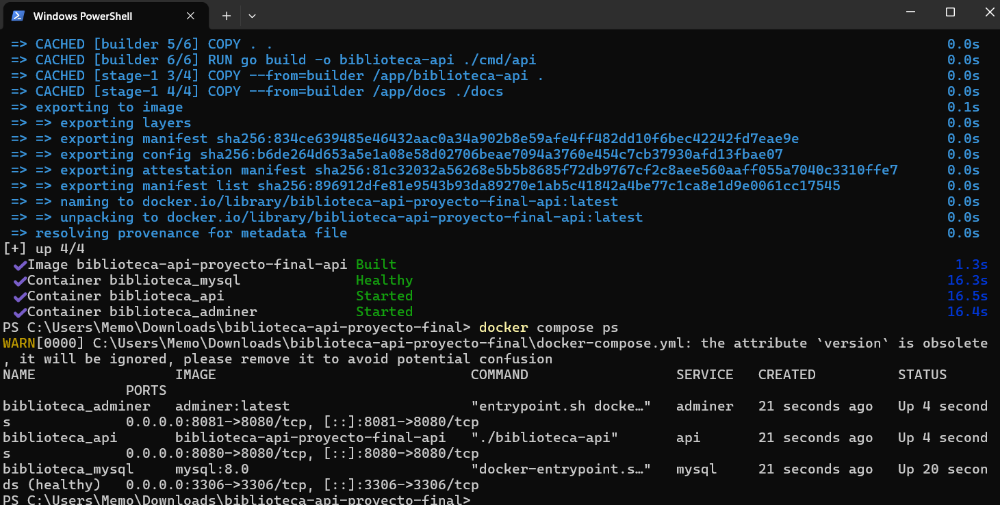
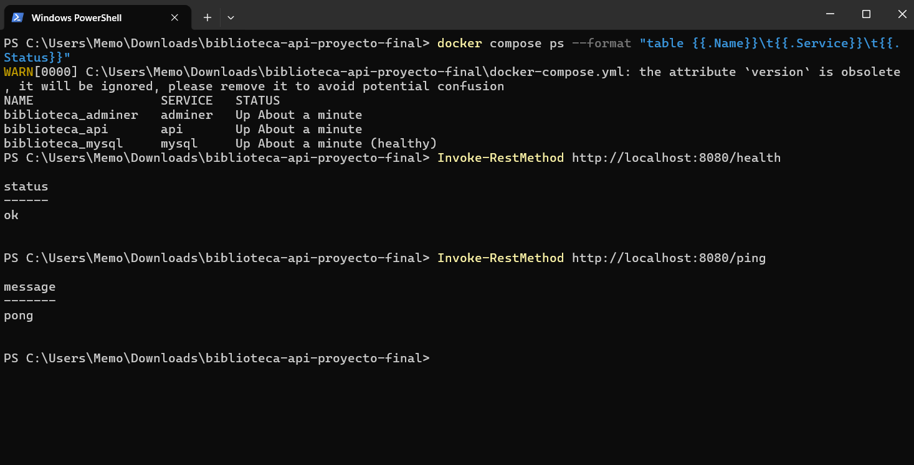
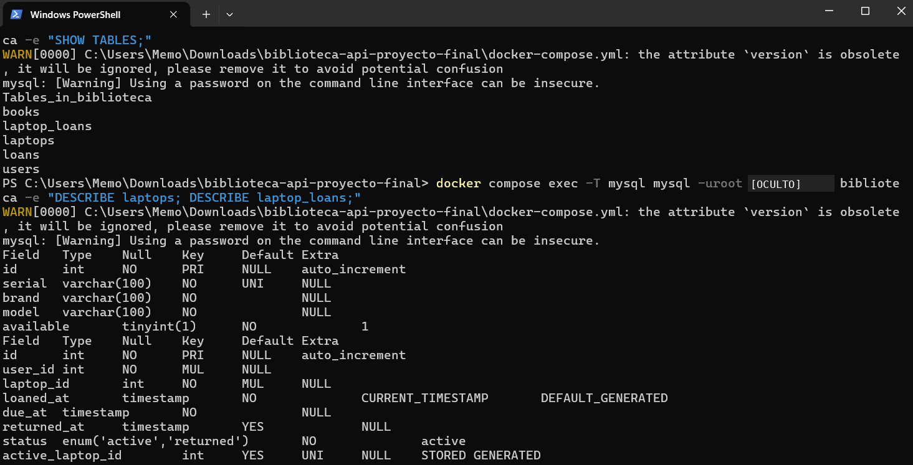
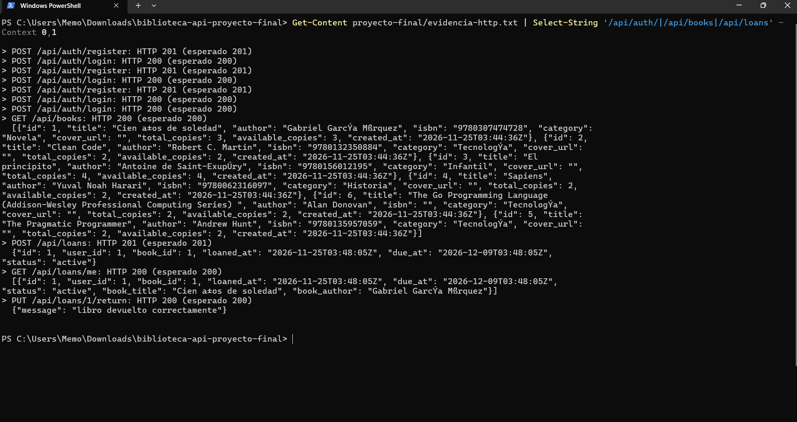
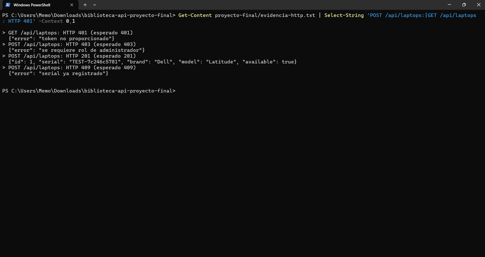
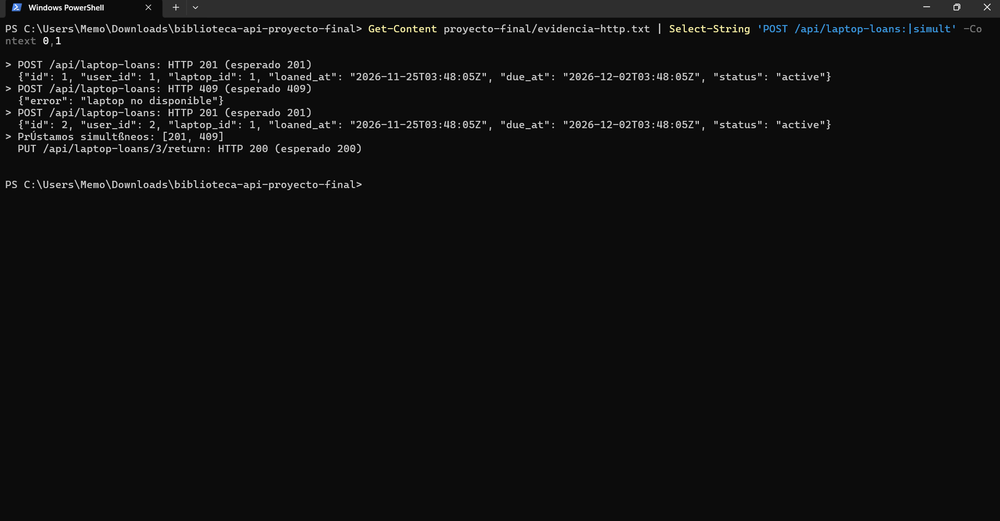
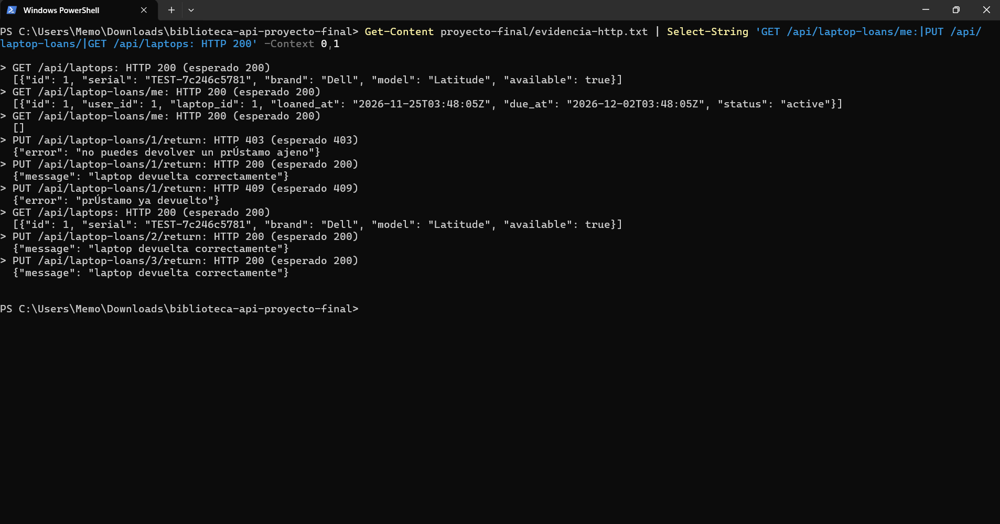
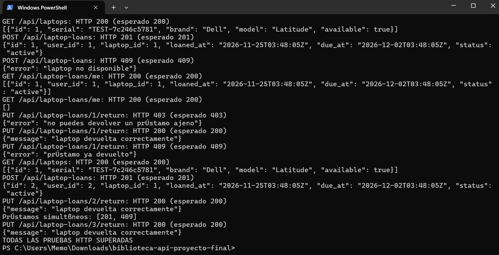

# Verificación del proyecto

**Estado:** ejecución local completada; todas las pruebas del script HTTP superadas.

**Fecha:** 24 de noviembre de 2026, hora de Colombia (las respuestas de la API registran el 25 de noviembre en UTC).

## 1. Preparación y ejecución

Se ejecutó `docker compose up -d --build` en Windows PowerShell. La aplicación en Go compiló y se construyó la imagen de Docker. Inicialmente se presentó un conflicto por el nombre del contenedor `biblioteca_mysql`, que ya existía en el proyecto original. Se detuvo ese proyecto con `docker compose down`, sin eliminar los volúmenes, y se inició el proyecto final. Los servicios API, MySQL y Adminer quedaron activos. MySQL reportó el estado `healthy`.



Se verificó la disponibilidad de los servicios con `docker compose ps` y se consultaron los endpoints `/health` y `/ping`, que respondieron `ok` y `pong`, respectivamente.



## 2. Base de datos

Se comprobó la migración `002_laptops.sql` mediante `SHOW TABLES` y `DESCRIBE laptops; DESCRIBE laptop_loans;`. Se encontraron las cinco tablas: `books`, `loans`, `users`, `laptops` y `laptop_loans`. La tabla de laptops tiene una restricción única sobre el serial y la tabla de préstamos tiene una restricción única sobre `active_laptop_id`, columna generada que ayuda a impedir préstamos activos duplicados.



Nota: se ocultó únicamente la contraseña visible en el comando de la captura SQL; los resultados de la consulta se conservaron.

## 3. Pruebas HTTP

Se utilizó Python 3.14.7 y se ejecutó el siguiente comando desde la raíz del proyecto:

```powershell
python scripts/verificar.py | Tee-Object -FilePath proyecto-final/evidencia-http.txt
```

El script registra usuarios de prueba, asigna el rol de administrador a uno de ellos en la base local y verifica respuestas HTTP y condiciones de negocio. Los registros de prueba permanecen en la base de desarrollo. El archivo de salida original debe conservarse en `proyecto-final/evidencia-http.txt` junto a este documento.

| Caso | Resultado esperado | Resultado observado | Estado |
|---|---|---|---|
| Docker build / ps | Tres servicios activos, MySQL healthy | Tres servicios activos, MySQL healthy | Superado |
| Health / ping | HTTP 200 y JSON esperado | 200, `ok` y `pong` | Superado |
| Registro y login | 201 / 200 | 201 / 200 | Superado |
| Catálogo libros | 200 | 200 | Superado |
| Préstamo, historial y devolución libro | 201 / 200 / 200 | 201 / 200 / 200 | Superado |
| Crear laptop admin / estudiante | 201 / 403 | 201 / 403 | Superado |
| Catálogo laptop autenticado / sin token | 200 / 401 | 200 / 401 | Superado |
| Serial duplicado | 409 | 409 | Superado |
| Préstamo laptop | 201 | 201 | Superado |
| Segundo préstamo del mismo equipo | 409 | 409 | Superado |
| Historial propio, aislamiento | 200; historial ajeno vacío | 200; registro propio y lista vacía para otro usuario | Superado |
| Devolución ajena / propia / repetida | 403 / 200 / 409 | 403 / 200 / 409 | Superado |
| Inventario disponible y nuevo préstamo | 200 / 201 | 200 (`available: true`) / 201 | Superado |
| Devolución administrativa | 200 | 200 | Superado |
| Solicitudes simultáneas | Un 201 y un 409 | `[201, 409]` | Superado |

### 3.1. Regresión del módulo de libros

Se comprobó el registro e inicio de sesión, la consulta de libros, el préstamo, la consulta de préstamos propios y la devolución. Las operaciones probadas del módulo original continuaron funcionando. El préstamo de libro mostrado tiene una duración de 14 días.



### 3.2. Registro de laptops y permisos

Una solicitud sin token recibió 401; el registro por un estudiante recibió 403; el administrador registró una laptop Dell Latitude con respuesta 201; un segundo registro con el mismo serial recibió 409.



### 3.3. Préstamos y concurrencia

El primer préstamo se registró con 201. El equipo no disponible generó 409. El plazo observado es de siete días. Dos solicitudes concurrentes para el mismo equipo produjeron `[201, 409]`, resultado esperado para impedir la doble asignación.



### 3.4. Historial y devoluciones

El titular visualizó su préstamo, mientras que otro usuario obtuvo un historial vacío. El intento de devolver un préstamo ajeno recibió 403, la devolución correcta recibió 200 y la devolución repetida recibió 409. Posteriormente se comprobó que la laptop estaba nuevamente disponible. También se verificó la devolución administrativa.



### 3.5. Resultado final

La ejecución terminó con el mensaje `TODAS LAS PRUEBAS HTTP SUPERADAS`.



Capturas complementarias: [inicio de la ejecución](../evidencias/09_complementaria_inicio_pruebas.png) y [continuación de las pruebas](../evidencias/10_complementaria_continuacion_pruebas.png).

## 4. Conclusión y alcance

Las pruebas realizadas respaldan el funcionamiento del módulo de laptops, la protección de sus operaciones mediante autenticación y roles, y la conservación de las operaciones originales de libros que fueron probadas. La prueba concurrente respalda el control de disponibilidad en el escenario evaluado. Las advertencias sobre el atributo `version` de Docker Compose y el uso de la contraseña MySQL en la línea de comandos no impidieron la ejecución. Algunos caracteres acentuados se muestran incorrectamente por la codificación de la consola; ello no alteró los códigos HTTP observados.

La verificación corresponde a un entorno local de desarrollo. No equivale a una auditoría integral de seguridad o rendimiento, ni a una ejecución de todos los endpoints originales. La documentación Swagger original no fue regenerada.
